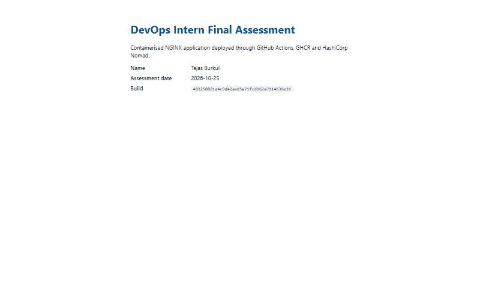
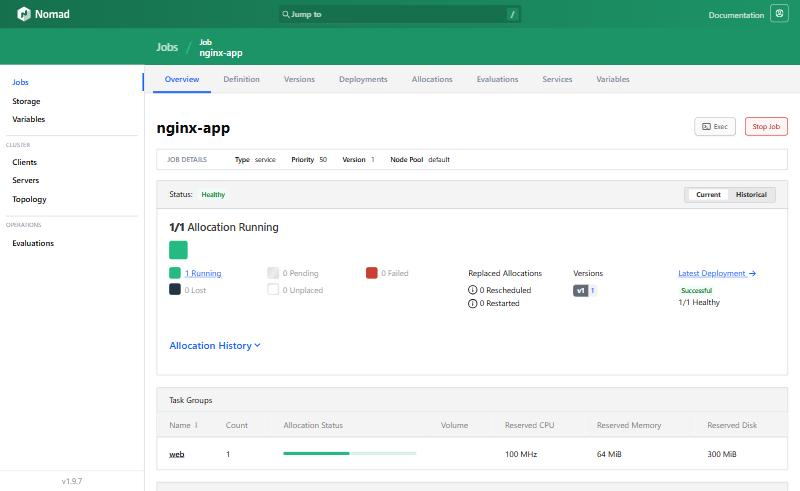
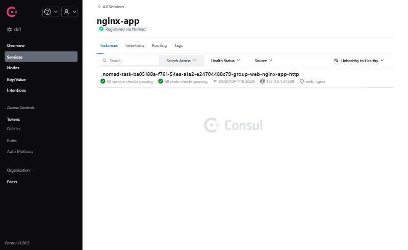
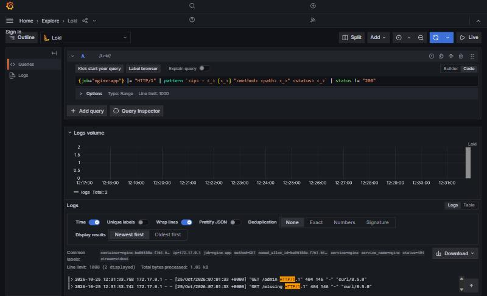

# devops-intern-final

[](https://github.com/tejas1121/devops-intern-final/actions/workflows/ci.yml)

**Name:** Tejas Burkul  **Submission date:** 2026-10-25  **Release:** `v1.0.0`

An end-to-end deployment pipeline for a containerised NGINX static site. Each stage consumes the previous stage's output: Git → GitHub Actions (lint, build, test) → GitHub Container Registry → HashiCorp Nomad (with Consul health checks) → Grafana Loki.

## Contents

- [Architecture](#architecture)
- [Prerequisites](#prerequisites)
- [Quick Start](#quick-start)
- [Task 1 — Source Control](#task-1--source-control)
- [Task 2 — Linux Scripting](#task-2--linux-scripting)
- [Task 3 — Containerisation](#task-3--containerisation)
- [Task 4 — Continuous Integration](#task-4--continuous-integration)
- [Task 5 — Orchestration with Nomad](#task-5--orchestration-with-nomad)
- [Task 6 — Log Aggregation with Loki](#task-6--log-aggregation-with-grafana-loki)
- [Troubleshooting](#troubleshooting)
- [Known Limitations](#known-limitations)

## Architecture

```text
 ┌──────────────┐  push / PR   ┌────────────────────────── GitHub Actions ──────────────────────────┐
 │  Git repo    │ ───────────▶ │  lint ──▶ build ──▶ test ──▶ publish (main only)                    │
 │  app/        │              │ shellcheck  docker build  docker run +   docker push                │
 │  scripts/    │              │ hadolint    BUILD_SHA     healthcheck.sh  :<sha> and :latest         │
 │  nomad/      │              └───────────────────────────────────────────────┬─────────────────────┘
 └──────────────┘                                                              ▼
                                                              ghcr.io/tejas1121/devops-intern-final:<sha>
                                                                               │ docker pull
                                                                               ▼
 ┌─────────────── Nomad (dev agent) ────────────────┐   register + /healthz   ┌──────────┐
 │ job nginx-app → group web → task nginx (docker)  │ ──────────────────────▶ │  Consul  │
 │ dynamic port "http" → container :8080            │                         └──────────┘
 └───────────────────────┬──────────────────────────┘
                         │ container stdout (access log)
                         ▼
          Promtail (docker_sd) ──▶ Loki :3100 ──▶ Grafana Explore :3000
```

## Prerequisites

Tested on Windows 11 with WSL2 (Ubuntu 24.04) and Docker Desktop. Any Linux host with Docker works.

| Tool | Version used | Purpose |
|---|---|---|
| Docker Engine / Desktop | 29.1.3 | Build and run the image |
| Docker Compose | v5.0.0 | Loki stack |
| Nomad | 1.9.7 | Orchestration |
| Consul | 1.20.5 | Service registry and health checks |
| ShellCheck | 0.10.0 | Script linting (CI uses the runner's copy) |
| Hadolint | 2.12.0 | Dockerfile linting |
| curl, git, bash | any recent | Scripts and Quick Start |

Install Nomad and Consul without root (that is how I installed them):

```bash
mkdir -p ~/bin && cd /tmp
curl -fsSLo nomad.zip  https://releases.hashicorp.com/nomad/1.9.7/nomad_1.9.7_linux_amd64.zip
curl -fsSLo consul.zip https://releases.hashicorp.com/consul/1.20.5/consul_1.20.5_linux_amd64.zip
unzip -o nomad.zip -d ~/bin && unzip -o consul.zip -d ~/bin && export PATH=~/bin:$PATH
```

## Quick Start

From clone to a running, monitored application, on a Linux/WSL shell with the prerequisites installed:

```bash
git clone https://github.com/tejas1121/devops-intern-final.git && cd devops-intern-final
consul agent -dev -client 127.0.0.1 > /tmp/consul.log 2>&1 &
nomad agent -dev -bind 127.0.0.1 -network-interface lo > /tmp/nomad.log 2>&1 &
sleep 10 && nomad node status
nomad job run -var="image_tag=$(git rev-parse v1.0.0^{commit})" nomad/nginx-app.nomad.hcl
nomad job status nginx-app
docker compose -f monitoring/docker-compose.yaml up -d
ADDR=$(curl -s 'localhost:8500/v1/health/service/nginx-app?passing' | python3 -c 'import sys,json;s=json.load(sys.stdin)[0]["Service"];print(f"{s["Address"]}:{s["Port"]}")')
scripts/healthcheck.sh "http://$ADDR/healthz"
```

Then open Grafana at <http://localhost:3000/explore>, or set `GRAFANA_PORT` if 3000 is taken. Nomad's UI is at <http://localhost:4646> and Consul's at <http://localhost:8500>.

> `image_tag` must be a commit SHA that CI has published to GHCR (any commit on `main`). The tag `v1.0.0` points at one.

## Task 1 — Source Control

- The history is incremental and uses conventional commits (`feat:`, `fix:`, `ci:`, `docs:`, `chore:`): run `git log --oneline`.
- The work was done on `feature/pipeline` and merged to `main` through a pull request with a self-review description.
- The final state is tagged `v1.0.0`.
- `.gitignore` excludes `.idea/`, `.vscode/` and other IDE metadata, plus `.env` files and image tarballs. `.gitattributes` forces LF line endings so scripts keep working inside Linux containers when the repo is cloned on Windows.

## Task 2 — Linux Scripting

Both scripts start with `#!/usr/bin/env bash` and `set -euo pipefail`. They are committed as executable (`git update-index --chmod=+x`, which shows as mode `100755` in `git ls-files -s scripts`) and pass ShellCheck.

```bash
$ docker run --rm -v "$PWD":/mnt -w /mnt koalaman/shellcheck:v0.10.0 scripts/sysinfo.sh scripts/healthcheck.sh
$ echo $?
0
```

### `scripts/sysinfo.sh`

Reports the user and effective UID, hostname and kernel, ISO-8601 date, disk usage, memory, and Docker daemon status. Sample output, captured inside a `bash:5.2` container:

```text
== User ==
User:          root
Effective UID: 0

== Host ==
Hostname:       f672f2f8d436
Kernel release: Linux 6.6.87.2-microsoft-standard-WSL2

== Date (ISO-8601) ==
2026-10-25T06:54:46+0000

== Disk usage ==
Filesystem                Size      Used Available Use% Mounted on
overlay                1006.9G     54.2G    901.4G   6% /

== Memory usage ==
              total        used        free      shared  buff/cache   available
Mem:           7.6G        2.3G      732.8M        5.2M        4.5G        5.1G
Swap:          2.0G           0        2.0G

== Docker daemon ==
Docker: not installed
```

### `scripts/healthcheck.sh [URL]`

Defaults to `http://localhost:8080`. It exits `0` on HTTP 200, `1` on any other response (including connection failure, reported as `000`), and `2` on bad usage or if curl is missing.

```text
$ scripts/healthcheck.sh http://localhost:8088
OK: http://localhost:8088 returned HTTP 200
$ scripts/healthcheck.sh http://localhost:8088/missing; echo "exit=$?"
FAIL: http://localhost:8088/missing returned HTTP 404 (expected 200)
exit=1
$ scripts/healthcheck.sh http://localhost:1; echo "exit=$?"
FAIL: http://localhost:1 returned HTTP 000 (expected 200)
exit=1
```

## Task 3 — Containerisation

`app/Dockerfile`:

- uses the pinned base `nginx:1.27-alpine`, never `latest`
- uses a custom `app/nginx.conf`: it listens on **8080**, serves `/healthz` returning `200 ok`, and logs to stdout
- runs as the non-root `nginx` user (uid 101). All writable NGINX paths (pid and temp dirs) are moved to `/tmp`.
- declares `EXPOSE 8080` and a `HEALTHCHECK` that calls `/healthz`
- takes a `BUILD_SHA` build argument and stamps it into the page and into an `X-Build-SHA` response header

```bash
$ SHA=$(git rev-parse HEAD)
$ docker build --build-arg BUILD_SHA=$SHA -t devops-intern-final:$SHA app
$ docker images devops-intern-final
IMAGE                                                          ID             DISK USAGE   CONTENT SIZE
devops-intern-final:482250881a4c9d42aed5a71fcd962a7114636e26   5449de1873ed       73.7MB           21MB
$ docker run -d --name nginx-app -p 8088:8080 devops-intern-final:$SHA
```

The image is **21 MB compressed**. Docker Desktop's containerd store reports 73.7 MB of "disk usage" because it counts both the compressed and unpacked layers. The CI `build` job enforces the 60 MB limit on the image size as Docker reports it, and fails the pipeline if the image is larger.

I used host port 8088 locally because a Jenkins server already holds 8080 on my machine (see [Troubleshooting](#troubleshooting)).

```text
$ curl -i http://localhost:8088/healthz
HTTP/1.1 200 OK
Server: nginx
Content-Type: text/plain
Content-Length: 3
X-Build-SHA: 482250881a4c9d42aed5a71fcd962a7114636e26

ok

$ curl -I http://localhost:8088/
HTTP/1.1 200 OK
Server: nginx
Content-Type: text/html
Content-Length: 911
X-Build-SHA: 482250881a4c9d42aed5a71fcd962a7114636e26

$ docker exec nginx-app id
uid=101(nginx) gid=101(nginx) groups=101(nginx)
$ docker inspect --format '{{.State.Health.Status}}' nginx-app
healthy
```



## Task 4 — Continuous Integration

`.github/workflows/ci.yml` runs on every push and pull request to `main`:

| Job | What it does |
|---|---|
| `lint` | Runs `shellcheck scripts/*.sh` and `hadolint` on `app/Dockerfile` |
| `build` | Runs `docker build --build-arg BUILD_SHA=${{ github.sha }}`, checks the image is under 60 MB, and saves it as an artifact |
| `test` | Loads the image, starts it, waits up to 30 s for `/healthz`, runs `scripts/healthcheck.sh` on `/` and `/healthz`, and checks that the page and the `X-Build-SHA` header contain the commit SHA. Any non-200 fails the job. |
| `publish` | Runs on **push to `main` only**. It logs in to GHCR with `GITHUB_TOKEN` and pushes `:<sha>` and `:latest` |

Security choices:

- The workflow sets `permissions: contents: read`. Only `publish` gets `packages: write`.
- There are no stored credentials. GHCR authentication uses the short-lived `GITHUB_TOKEN`.
- Third-party actions are pinned to a major version: `actions/checkout@v4`, `actions/upload-artifact@v4`, `actions/download-artifact@v4`, `hadolint/hadolint-action@v3.1.0`, `docker/login-action@v3`.
- The same image that passed `test` is the one published. `publish` loads the artifact instead of rebuilding.

The pipeline runs are on the [Actions tab](https://github.com/tejas1121/devops-intern-final/actions/workflows/ci.yml). Published images are listed under the repository's Packages.

## Task 5 — Orchestration with Nomad

`nomad/nginx-app.nomad.hcl` defines:

- a `type = "service"` job with one group (`web`) and one task (`nginx`) using the `docker` driver
- the image `${var.image_repo}:${var.image_tag}`. The tag is a required HCL variable, so you always deploy a specific commit SHA and never `latest`.
- resources of **100 MHz CPU and 64 MB memory**. That is enough: the running task used 13 MiB, as shown below.
- a dynamic port named `http` mapped to container port `8080`
- a Consul service `nginx-app` with an HTTP check on `/healthz` (interval 10s, timeout 2s)
- an `update` block with `max_parallel = 1`, `min_healthy_time = "10s"`, `healthy_deadline = "2m"`, `auto_revert = true` and `health_check = "checks"`
- a `restart` block (3 attempts in 5 minutes, then fail) and a `reschedule` block (exponential back-off from 30s to 5m)
- Docker labels `com.hashicorp.nomad.job_name` and `task_name`, which Promtail uses for log labels (see Task 6)

Run against a Nomad 1.9.7 and Consul 1.20.5 dev agent in WSL:

```text
$ nomad job validate -var="image_tag=$SHA" nomad/nginx-app.nomad.hcl
Job validation successful

$ nomad job plan -var="image_tag=$SHA" nomad/nginx-app.nomad.hcl
+ Job: "nginx-app"
+ Task Group: "web" (1 create)
  + Task: "nginx" (forces create)

Scheduler dry-run:
- All tasks successfully allocated.

$ nomad job run -var="image_tag=$SHA" nomad/nginx-app.nomad.hcl
==> Monitoring evaluation "0dc69338"
    Allocation "27aff125" created: node "f82df8fc", group "web"
==> Monitoring deployment "19b8ebc2"
ID          = 19b8ebc2
Job ID      = nginx-app
Status      = successful
Description = Deployment completed successfully

Deployed
Task Group  Auto Revert  Desired  Placed  Healthy  Unhealthy  Progress Deadline
web         true         1        1       1        0          2026-10-25T07:09:54Z

$ nomad job status nginx-app
Status        = running
Summary
Task Group  Queued  Starting  Running  Failed  Complete  Lost  Unknown
web         0       0         1        0       0         0     0
Latest Deployment
Status      = successful
Allocations
ID        Node ID   Task Group  Version  Desired  Status   Created  Modified
27aff125  f82df8fc  web         0        run      running  34s ago  9s ago

$ nomad alloc status 27aff125
Deployment Health   = healthy
Allocation Addresses:
Label  Dynamic  Address
*http  yes      127.0.0.1:27122 -> 8080
Task Resources:
CPU        Memory         Disk
0/100 MHz  13 MiB/64 MiB  300 MiB

$ curl -s http://127.0.0.1:8500/v1/health/checks/nginx-app
healthz passing HTTP GET http://127.0.0.1:27122/healthz: 200 OK Output: ok
```

Changing the job (I added the Docker labels) and running it again produced **job version 1**. Nomad performed a rolling update: the new allocation passed its Consul check for 10s before the deployment was marked successful.




## Task 6 — Log Aggregation with Grafana Loki

`monitoring/docker-compose.yaml` starts Loki 3.2.1, Promtail 3.2.1 and Grafana 11.3.0. All of their configuration is committed: `loki-config.yaml`, `promtail-config.yaml` and `grafana-datasources.yaml`. Promtail discovers containers through the Docker socket and attaches the labels `job`, `container`, `service`, `nomad_alloc_id` and `stream`.

```bash
docker compose -f monitoring/docker-compose.yaml up -d
```

This query isolates NGINX access-log lines that are not 200s, after deliberately requesting `/missing` and `/admin`:

```logql
{job="nginx-app"} |= "HTTP/1" | pattern `<ip> - <_> [<_>] "<method> <path> <_>" <status> <_>` | status != "200"
```

```text
{job="nginx-app", service="nginx", nomad_alloc_id="ba05188a-...", status="404", path="/missing"}  "GET /missing HTTP/1.1" 404
{job="nginx-app", service="nginx", nomad_alloc_id="ba05188a-...", status="404", path="/admin"}    "GET /admin HTTP/1.1" 404
```

[`monitoring/loki_setup.md`](monitoring/loki_setup.md) records how I started the stack, the label set, the queries and their results, and the problems I fixed.



## Troubleshooting

Real failures I hit while building this:

1. **`healthcheck.sh` returned 403 and the response was a Jenkins login page.** A local Jenkins already listens on host port 8080, and the request reached Jenkins instead of the container. I published the container on another host port with `-p 8088:8080`. The container itself still listens on 8080.
2. **Grafana failed with `Bind for 0.0.0.0:3000 failed: port is already allocated`.** Another service holds port 3000. The Compose file now reads the port from `${GRAFANA_PORT:-3000}`, and I ran it with `GRAFANA_PORT=3001`.
3. **Loki had no `job="nginx-app"` stream for the Nomad allocation.** `docker inspect` showed Nomad only adds `com.hashicorp.nomad.alloc_id` by default. I added a `labels = { ... }` map to the task config. My first attempt used block syntax, `labels { "..." = ... }`, which fails validation with `Argument names must not be quoted`.
4. **The "non-200" LogQL query matched NGINX startup messages.** Lines without an HTTP status produce an empty `status`, and an empty value is `!= "200"`. A `|= "HTTP/1"` line filter before `pattern` fixes this.
5. **Nomad commands typed through PowerShell broke on the space in `C:\Users\Tejas Burkul`.** I ran the Nomad commands from a Bash shell inside WSL instead of `wsl -- bash -lc "..."`.

## Known Limitations

These parts are not production-ready, and this is what I would change with more time:

- **Single-node dev agents.** Nomad and Consul run with `-dev`: in-memory state, no ACLs, no TLS, one node. Production needs a 3- or 5-server cluster with ACLs and mTLS, and Consul Connect for service-to-service traffic.
- **No ingress.** The app is reachable only on a dynamic port on `127.0.0.1`. I would add a load balancer (Traefik or Fabio) that reads the Consul catalog, and TLS.
- **Grafana runs with anonymous admin access** to make local review easy. It must be disabled for any shared environment.
- **Loki uses local filesystem storage** with 7-day retention and no replication. Production would use object storage (S3/GCS) and a scalable deployment.
- **Promtail needs the Docker socket**, which is effectively root on the host. Grafana Alloy, or Nomad's own log shipping, would be a safer collector. Promtail is also in maintenance mode upstream.
- **CI pins actions to a major version, not a commit SHA,** and does not sign images or produce an SBOM. With more time I would pin SHAs with Dependabot updates and add cosign signing and a Trivy scan.
- **The `latest` tag is still pushed** for convenience. Deployments never use it, because Nomad requires an explicit SHA.
- **`count = 1`,** so a rolling update has a brief window with zero healthy instances. Two or more instances, or `canary = 1`, would give zero-downtime deploys.
